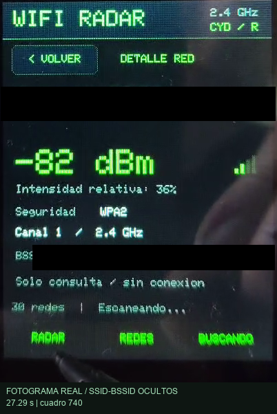
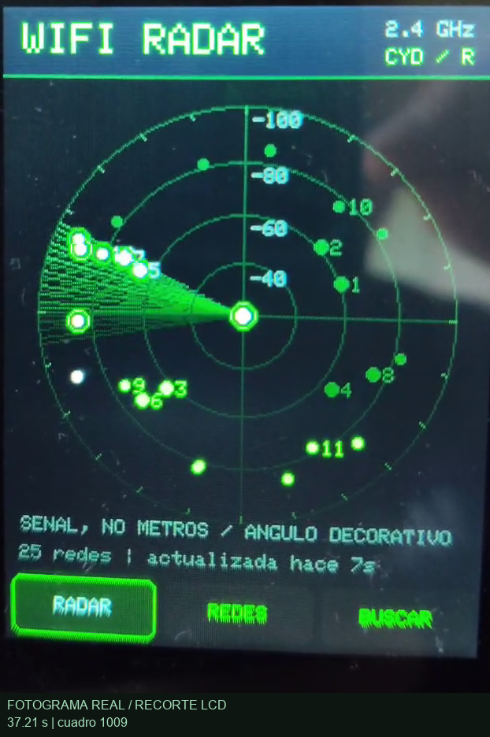

# AB Displays Lab
### Pantallas reales · proyectos de MS Robotika

**Primera demostración: Radar WiFi para CYD ESP32**

[Ver el proyecto](examples/radar-wifi-cyd/) · [AB MakerIDE SUPER](https://github.com/msrobotika/AB-MakerIDE-SUPER) · [Instalar el IDE](https://github.com/msrobotika/AB-MakerIDE-SUPER/blob/main/docs/DESCARGAS_Y_VERSIONES.md)

Un radar verde que representa la intensidad de las redes WiFi de **2,4 GHz** en una CYD: barrido animado, lista táctil por señal y detalle por punto de acceso. Proyecto aportado por Abel, creado con AB MakerIDE SUPER. La interfaz se ejecuta en la placa.

**El radio representa RSSI relativo; el ángulo es decorativo. No mide metros ni dirección.** El firmware solicita escaneos pasivos y no se asocia a las redes.

## Un vistazo

| Radar e interacción | Redes disponibles |
|:---:|:---:|
|  |  |
| **Detalle de red** | **Barrido en pantalla** |
|  |  |

[Galería completa de ocho capturas y procedencia](docs/GALERIA.md). Son fotogramas reales del vídeo aportado: recortados al LCD y anonimizados, sin imágenes generadas. Se han extraído de nuevo del vídeo; no se presentan como los PNG idénticos del pack anterior.

## Qué incluye

- **Radar:** contactos numerados, anillos RSSI y actualización automática ocho segundos después de cada resultado.
- **Redes:** hasta 48 AP ordenados por señal, cinco por página; SSID, seguridad y dBm en la placa.
- **Detalle:** SSID, BSSID, canal, seguridad e intensidad; selección estable por BSSID.
- **Táctil:** calibración de tres puntos guardada en NVS. Mantener BOOT 1,2 s permite repetirla.
- **Autopruebas:** funciones de producción para RSSI, top48, identidad, páginas, calibración y nombres.

## Abrir y compilar

1. Abre [examples/radar-wifi-cyd/sketch.ino](examples/radar-wifi-cyd/sketch.ino) en [AB MakerIDE SUPER](https://github.com/msrobotika/AB-MakerIDE-SUPER), junto a las dos cabeceras.
2. Prepara el núcleo y las bibliotecas indicados en la [guía del proyecto](examples/radar-wifi-cyd/README.md).
3. Desde la raíz del repositorio, ejecuta `python examples/radar-wifi-cyd/scripts/build.py` con Arduino CLI instalado.

La utilidad **solo compila** y prepara una carpeta Arduino con nombre válido. La guía detalla pines, FQBN y controles.

## Qué está demostrado

| Evidencia | Alcance |
|---|---|
| Vídeo aportado y ocho fotogramas | LCD físico con radar, lista, detalle y uso de lápiz; no es una prueba exhaustiva de todas las funciones. |
| Compilación de esta incorporación | Resultado, versiones y tamaños en [VALIDACION.md](docs/VALIDACION.md). |
| `MAKERIDE_EXPORT.json` original | Declara `flash_reported_verified`; no sustituye un registro de carga ni demuestra la revisión del LCD. |
| Autopruebas al arrancar | Incluidas en el firmware. Su ejecución en la placa no se ha repetido en esta incorporación. |

No se ha grabado ni conectado una placa durante esta preparación. [Evidencias y límites](docs/EVIDENCIA.md) · [Procedencia y privacidad](docs/PROCEDENCIA_Y_PRIVACIDAD.md).

## Mapa del laboratorio

| Ruta | Contenido |
|---|---|
| [examples/radar-wifi-cyd/](examples/radar-wifi-cyd/) | Firmware real, guía y referencias del IDE |
| [docs/images/radar-wifi-cyd/](docs/images/radar-wifi-cyd/) | Ocho PNG, tiempos y máscaras de privacidad |
| [docs/](docs/) | Galería, validación y procedencia |
| [specs/001-import-radar/](specs/001-import-radar/) | Especificación, plan, tareas y aceptación |

Repositorio privado. Sin releases ni volcados de firmware. Los originales privados y las copias del dispositivo quedan fuera de Git. No se añade una licencia nueva sin decisión del autor; las dependencias y referencias conservan sus condiciones.
